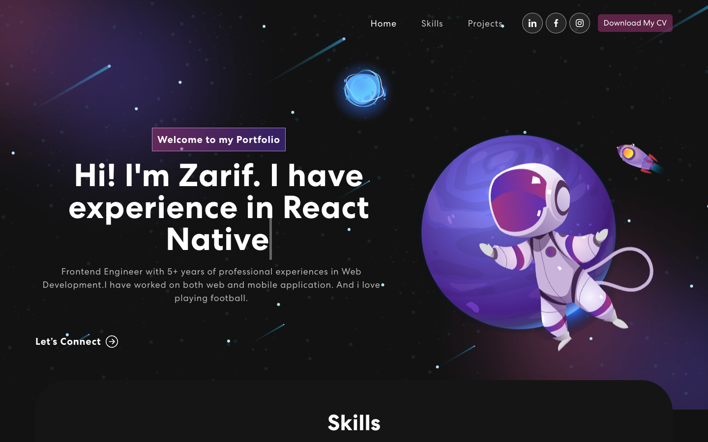
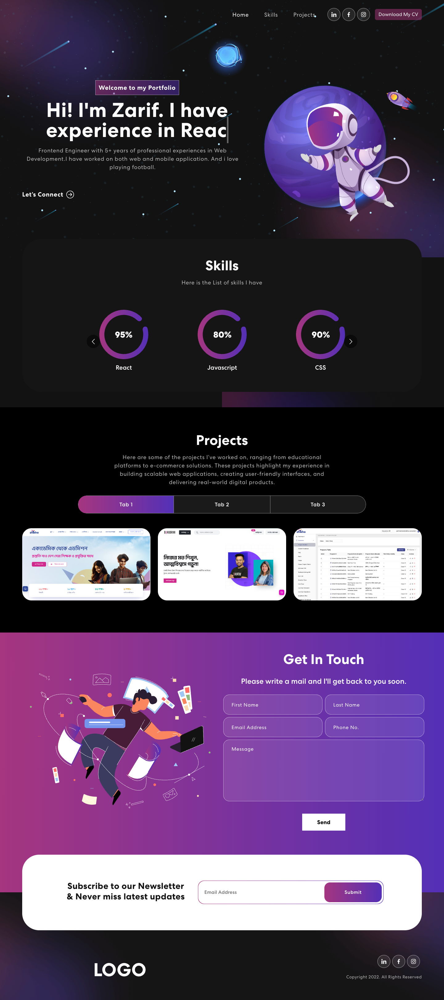
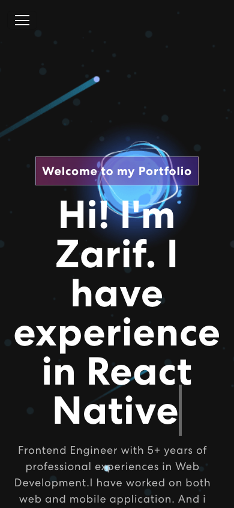

# Personal Portfolio — Zarif Shahriar Rahman

A personal portfolio website for Zarif Shahriar Rahman, a Frontend Engineer with 5+ years of experience in web and mobile development. Built with React, the site features a space-themed design, a typing animation in the hero, an animated skills carousel, tabbed project showcases, a working contact form, and a newsletter subscription.



## Screenshots

| Full Page | Mobile |
|:---:|:---:|
|  |  |

## Features

- **Hero banner** — typewriter animation cycling through "React Native" and "React", with a link to connect on LinkedIn
- **Skills** — infinite carousel (react-multi-carousel) showing skill meters for React, JavaScript, CSS, and React Native
- **Projects** — tabbed gallery of real-world projects with hover effects and live links
- **Contact form** — powered by EmailJS; sends emails directly from the client with toast notifications via react-toastify
- **Newsletter** — Mailchimp subscription form in the footer
- **CV download** — one-click download of the CV from the navbar
- **Animations** — scroll-triggered entrance animations (react-on-screen + animate.css) and a navbar that changes style on scroll
- **Responsive design** — fully responsive layout built with Bootstrap 5

## Tech Stack

- **React 18** (Create React App)
- **React Bootstrap** + Bootstrap 5
- **EmailJS** (`@emailjs/browser`) for contact form emails
- **Mailchimp** (`react-mailchimp-subscribe`) for newsletter signup
- **react-multi-carousel** for the skills slider
- **react-on-screen** + **animate.css** for scroll animations
- **react-toastify** for notifications

## Featured Projects

| Project | Description |
| --- | --- |
| [Shikho](https://shikho.com/) | Educational platform |
| [Bohubrihi](https://bohubrihi.com/) | Online learning platform |
| [Shikho CMS](https://cms.shikho.com/) | Content management system |
| [Shikho Shop](https://shop.shikho.com/) | E-commerce platform |
| [Grameen Digital Health](https://grameendh.com/) | Digital health website |
| [DX Ball](https://dx-ball-six.vercel.app/) | Browser game |
| [OnePDF](https://onepdf-three.vercel.app/) | In-browser PDF manager |

## Project Structure

```
src/
├── components/
│   ├── NavBar.js        # Navigation bar with CV download & social links
│   ├── Banner.js        # Hero section with typewriter animation
│   ├── Skills.js        # Skills carousel
│   ├── Projects.js      # Tabbed projects gallery
│   ├── ProjectCard.js   # Individual project card
│   ├── Contact.js       # Contact form (EmailJS)
│   ├── Newsletter.js    # Newsletter form UI
│   ├── MailchimpForm.js # Mailchimp subscription logic
│   └── Footer.js        # Footer with logo & social icons
├── assets/              # Images, fonts and CV
├── App.js               # Root component
└── index.js             # Entry point
```

## Getting Started

### Prerequisites

- Node.js (v14 or later)
- Yarn (or npm)

### Installation

1. Clone the repository

   ```bash
   git clone https://github.com/zarifRahman/My-Portfolio.git
   cd My-Portfolio
   ```

2. Install dependencies

   ```bash
   yarn install
   ```

3. Create a `.env` file in the project root (see [Environment Variables](#environment-variables))

4. Start the development server

   ```bash
   yarn start
   ```

   The app opens at `http://localhost:3000`.

### Build for production

```bash
yarn build
```

The optimized build is output to the `build/` folder.

## Environment Variables

Create a `.env` file in the project root with the following variables:

### EmailJS (contact form)

| Variable | Description |
| --- | --- |
| `REACT_APP_EMAILJS_SERVICE_ID` | EmailJS service ID |
| `REACT_APP_EMAILJS_TEMPLATE_ID` | EmailJS email template ID |
| `REACT_APP_EMAILJS_PUBLIC_KEY` | EmailJS public key |

### Mailchimp (newsletter)

| Variable | Description |
| --- | --- |
| `REACT_APP_MAILCHIMP_URL` | Mailchimp list subscribe URL |
| `REACT_APP_MAILCHIMP_U` | Mailchimp `u` parameter |
| `REACT_APP_MAILCHIMP_ID` | Mailchimp audience/list ID |

Sign up at [EmailJS](https://www.emailjs.com/) and [Mailchimp](https://mailchimp.com/) to get these credentials.

## Connect

- **LinkedIn** — [zarif-shahriar-rahman](https://www.linkedin.com/in/zarif-shahriar-rahman-634142173/)
